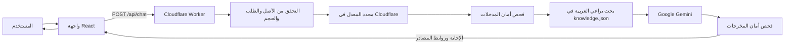

# 🕌 مساعد تطبيقات المسلم

**مساعد ثنائي اللغة للتعرّف على التطبيقات الإسلامية النافعة والاطلاع على مواقيت الصلاة.**

[النسخة الحية](https://cooolv.github.io/Muslim-Bot/) · [دليل التشغيل](#التشغيل-السريع) · [الإبلاغ عن مشكلة](https://github.com/cooolv/Muslim-Bot/issues)

[](LICENSE)
[](https://github.com/cooolv/Muslim-Bot/actions/workflows/pages.yml)
[](https://www.typescriptlang.org/)
[](https://github.com/cooolv/Muslim-Bot/commits/main)
[](https://github.com/cooolv/Muslim-Bot/pulls)

**اللغة:** [English](README.md) · العربية

## معاينة

> **الصورة مطلوبة:** أضف لقطة شاشة أو صورة متحركة حقيقية للتطبيق في `docs/images/preview.png`. لا تتوفر لقطة للمشروع حاليًا.


## لماذا هذا المشروع؟

قد يضطر الباحثون عن تطبيقات نافعة إلى التنقل بين مصادر متفرقة. يجمع مساعد تطبيقات المسلم معلومات التطبيقات وروابط مصادرها وأدوات مواقيت الصلاة في تطبيق ويب عربي وإنجليزي. كما يتيح للمطورين الاطلاع على مثال عملي صغير لمساعد عربي يستخدم التوليد المعزّز بالاسترجاع (RAG).

## المزايا

- **إجابات تستند إلى قاعدة المعرفة:** يبحث Cloudflare Worker في السجلات المنشورة داخل `public/knowledge.json`، ثم يرسل المعلومات المطابقة وروابط مصادرها إلى Gemini.
- **اقتراحات عامة للتطبيقات:** عند طلب تطبيق إسلامي نافع دون تحديد فئة أو اسم تطبيق، يختار Worker مجموعة منتقاة من التطبيقات الموجودة فعلًا في قاعدة المعرفة ويرفق مصادرها.
- **استرجاع يراعي العربية:** يطبّع البحث الحروف والتشكيل العربي، ويعالج بعض السوابق واللواحق الشائعة، ثم يرتب السجلات بحسب صلتها.
- **مواقيت الصلاة والبحث عن المدن:** ابحث عن مدينة أو اسمح للمتصفح باستخدام الموقع، ثم اطلب المواقيت من Aladhan. تعرض الصفحة الصلوات الخمس والتاريخ الهجري والصلاة القادمة.
- **عرض قابل للتخصيص:** غيّر اللغة بين العربية والإنجليزية، والمظهر بين الفاتح والداكن، وحجم نص الرسائل ولون التمييز، واختر ما إذا كان رد المساعد بلون خلفية مختلف.
- **تفضيلات وسجل محادثات محليان:** تُحفظ المحادثات وتفضيلات العرض والمدينة المختارة وحالة زر التذكير في المتصفح. ويمكن استعادة تفضيلات العرض الافتراضية من الإعدادات.
- **حماية متعددة الطبقات للطلبات:** يتحقق Worker من الأصول وبنية الطلب وحجمه، ويستخدم تحديد المعدل من Cloudflare، ويفحص المدخلات والمخرجات، ويحفظ مفتاح Gemini على الخادم.
- **روابط المصادر:** قد تتضمن الإجابة روابط السجلات التي استُخدمت في البحث.
- **اقتراحات معرفة يراجعها المسؤول:** يمكن للجميع اقتراح معلومات موثقة عبر بلاغ GitHub عام. لا تدخل الاقتراحات في الإجابات إلا بعد مراجعتها وإضافتها إلى ملف المعرفة المنشور بواسطة المسؤول.

**التذكيرات المجدولة للصلاة غير منفذة حاليًا.** زر التذكير يحفظ تفضيلًا محليًا فقط، ولا يجدول إشعارات ولا يرسلها.

## كيف يعمل؟



يرسل المتصفح السؤال الحالي وعددًا محدودًا من رسائل المحادثة السابقة إلى `/api/chat`، ولا يتصل بـ Gemini مباشرة. يتولى Worker التحقق من الأصل والطلب، وتحديد المعدل، وفحص المدخلات، واسترجاع المعرفة، وفحص المخرجات. ويضمّن `public/knowledge.json` عند البناء، ثم يختار السجلات ذات الصلة باستخدام أدوات البحث العربية المشتركة ويرسلها إلى Gemini كسياق مرجعي.

يعمل تحديد معدل الطلبات عند حدود Worker، أما فحص المدخلات والمخرجات فيعمل داخله باستخدام شيفرة المشروع المشتركة. تقلل هذه التدابير المخاطر، لكنها لا تضمن منع كل إجابة غير آمنة أو غير صحيحة.

## التشغيل السريع

### المتطلبات

- Node.js 22 (الإصدار المستخدم في سير عمل GitHub Actions) وnpm.
- [مفتاح Google Gemini API](https://aistudio.google.com/apikey) للمحادثة محليًا أو لتشغيل Worker منشور.
- Python 3.12 فقط إذا رغبت في تشغيل مجموعة اختبارات Python القديمة.

### تشغيل تطبيق الويب وWorker محليًا

1. ثبّت اعتمادات JavaScript:

   ```bash
   npm ci
   ```

2. أنشئ ملفًا باسم `.dev.vars` في جذر المشروع، وضع فيه `GEMINI_API_KEY` الخاص بك. لا ترفع المفتاح إلى Git ولا تضعه في متغير يبدأ بـ `VITE_`.

3. في نافذة طرفية، شغّل Worker محليًا:

   ```bash
   npm run worker:dev
   ```

4. في نافذة أخرى، أنشئ `.env.local` واضبط `VITE_CHAT_API_URL` على عنوان Worker المحلي الذي يعرضه Wrangler (عادةً `http://localhost:8787`). ثم شغّل Vite:

   ```bash
   npm run dev
   ```

5. افتح عنوان Vite المحلي الذي يظهر في الطرفية.

أصل Worker المحلي موجود ضمن إعداد `ALLOWED_ORIGINS` في المستودع. إذا غيّرت عنوان التطوير أو المنفذ، حدّث هذا الإعداد وأعد تشغيل Worker.

### تشغيل الفحوص

```bash
npm test
npm run typecheck
npm run build
```

لتشغيل اختبارات Python القديمة أيضًا:

```bash
python -m pip install -r requirements-dev.txt
python -m pytest -q
```

## الإعدادات

لا يقرأ تطبيق الويب الحالي إعدادات `.env` الخاصة ببوت Python القديم. اضبط عنوان الواجهة محليًا عبر `VITE_CHAT_API_URL`، واحفظ مفتاح Gemini كسر في Cloudflare. هذه أسماء إعدادات نشر الويب الحالية:

| الاسم | الغرض | موضع الإعداد |
| --- | --- | --- |
| `VITE_CHAT_API_URL` | عنوان Worker العام الذي تتصل به الواجهة، ويُضمّن في بناء الواجهة. ليس سرًا. | ملف `.env.local` محليًا أو متغير مستودع GitHub Actions |
| `GEMINI_API_KEY` | بيانات الاعتماد التي يستخدمها Worker للاتصال بـ Gemini. | `.dev.vars` عند تشغيل Wrangler محليًا، أو سر Worker في Cloudflare عند النشر |
| `GEMINI_MODEL` | اسم نموذج Gemini الذي يستخدمه Worker. | متغير في `wrangler.jsonc`، ويمكن تغييره في بيئة Worker |
| `ALLOWED_ORIGINS` | أصول المتصفح المسموح بها، مفصولة بفواصل. | متغير في `wrangler.jsonc` |
| `CHAT_RATE_LIMITER` | ربط تحديد المعدل في Cloudflare الذي يستخدمه Worker. | مُعدّ في `wrangler.jsonc`، وليس سرًا للتطبيق |

لا تضع `GEMINI_API_KEY` أو أي بيانات اعتماد أخرى في `VITE_*` أو شيفرة الواجهة أو ملفات تُرفع إلى Git. لإعدادات وحدات Python القديمة أسماء خاصة بها، لكنها لا تدخل في تشغيل الويب الحالي.

## النشر

الموقع وخدمة المحادثة هدفا نشر منفصلان. بعد إضافة بيانات اعتماد Cloudflare إلى أسرار GitHub مرة واحدة، يؤدي الدفع إلى `main` بعد نجاح البناء والاختبارات إلى نشرهما تلقائيًا. لا تنشر طلبات الدمج أيًا منهما.

### الواجهة: GitHub Pages

1. من إعدادات المستودع، انتقل إلى **Settings → Secrets and variables → Actions → Variables**، ثم أضف متغير المستودع `VITE_CHAT_API_URL` واجعل قيمته عنوان Worker المنشور.
2. من **Settings → Pages**، اختر **GitHub Actions** مصدرًا للبناء والنشر.
3. ادفع التغيير أو ادمجه في `main`. يشغّل سير العمل `.github/workflows/pages.yml` الاختبارات والفحوص ويبني الموقع الثابت وينشره إلى GitHub Pages. تشغّل طلبات الدمج الفحوص والبناء فقط دون نشر.

### الخادم: Cloudflare Workers

أضف بيانات الاعتماد التالية مرة واحدة من **إعدادات مستودع GitHub → Secrets and variables → Actions → New repository secret**:

- `CLOUDFLARE_API_TOKEN`: أنشئ [رمز API في Cloudflare](https://developers.cloudflare.com/fundamentals/api/get-started/create-token/) بصلاحية تعديل Workers ومقيّدًا بالحساب المطلوب، واحفظه كسر.
- `CLOUDFLARE_ACCOUNT_ID`: [معرّف حساب Cloudflare](https://developers.cloudflare.com/fundamentals/account/find-account-and-zone-ids/) الذي يحتوي Worker. احفظه كسر في المستودع أيضًا.

يستخدم سير العمل هذين السرّين لتشغيل `npm run worker:deploy` بعد نجاح البناء عند الدفع إلى `main`. ولا يتيح أسرار النشر لوظائف طلبات الدمج. احتفظ بسر Worker الحالي `GEMINI_API_KEY` مضبوطًا في Cloudflare؛ رمز النشر لا يحل محله.

اضبط متغير GitHub Actions `VITE_CHAT_API_URL` على عنوان Worker، وتأكد من وجود أصل الواجهة ضمن `ALLOWED_ORIGINS`. بعد الإعداد لمرة واحدة، يؤدي دمج تغيير معرفة معتمد في `main` إلى نشر Worker تلقائيًا؛ لا حاجة إلى تشغيل أمر Wrangler يدويًا لكل تغيير. يظل `npm run worker:deploy` متاحًا للنشر اليدوي عند الحاجة.

قد تتغير الخطط والحصص والحدود لدى Cloudflare وGemini. راجع [حدود Cloudflare Workers](https://developers.cloudflare.com/workers/platform/limits/) و[حدود Gemini API](https://ai.google.dev/gemini-api/docs/rate-limits) وإعدادات حسابك قبل النشر؛ لا يضمن هذا المشروع استخدامًا مجانيًا أو غير محدود.

## بنية المشروع

```text
.
├── .github/workflows/pages.yml  # سير عمل الفحوص والبناء والنشر إلى GitHub Pages
├── bot/                         # وحدات Python قديمة؛ لا تدخل في تشغيل الويب
│   ├── __init__.py              # حزمة البوت القديم
│   ├── arabic.py                # أدوات البحث العربي القديمة
│   ├── assistant.py             # تنسيق عمل المساعد القديم
│   ├── blocklist.py             # دعم قائمة الحظر القديمة
│   ├── config.py                # إعدادات بيئة Python القديمة
│   ├── countries.py             # بيانات البلدان وطرق حساب الصلاة القديمة
│   ├── db.py                    # طبقة البيانات القديمة
│   ├── guard.py                 # فحوص الأمان القديمة
│   ├── knowledge.py             # أدوات فهرسة المعرفة القديمة
│   ├── llm.py                   # عميل النماذج اللغوية القديم
│   ├── prayer.py                # أدوات مواقيت الصلاة القديمة
│   └── prompts.py               # تعليمات المساعد القديم
├── data/.gitkeep                # يحافظ على مجلد بيانات النسخة القديمة الفارغ
├── index.html                   # نقطة دخول Vite
├── public/knowledge.json        # سجلات المعرفة المنشورة
├── src/
│   ├── App.tsx                  # واجهة React والمحادثة وصفحة مواقيت الصلاة
│   ├── chat.ts                  # عميل المحادثة بين المتصفح وWorker
│   ├── core.ts                  # الأنواع والبحث العربي وفحوص الأمان والتخزين المحلي
│   ├── core.test.ts             # اختبارات النواة والواجهة
│   ├── main.tsx                 # نقطة دخول الواجهة
│   ├── styles.css               # تنسيقات التطبيق
│   └── vite-env.d.ts            # تعريفات أنواع بيئة Vite
├── tests/                        # اختبارات وحدات Python القديمة
│   ├── __init__.py               # حزمة اختبارات Python
│   ├── conftest.py               # إعداد اختبارات Python
│   ├── test_arabic.py            # اختبارات البحث العربي القديم
│   ├── test_assistant.py         # اختبارات المساعد القديم
│   ├── test_guard.py             # اختبارات الأمان القديمة
│   ├── test_knowledge.py         # اختبارات فهرسة المعرفة القديمة
│   └── test_prayer.py            # اختبارات أدوات الصلاة القديمة
├── worker/src/
│   ├── index.ts                 # Cloudflare Worker للمحادثة واسترجاع المعرفة
│   └── index.test.ts            # اختبارات Worker بمحاكاة Gemini
├── .env.example                 # مثال لمتغير عنوان الواجهة العام
├── .gitignore                   # استثناء الأسرار والاعتمادات وملفات البناء المحلية
├── LICENSE                      # رخصة MIT
├── README.md                    # توثيق المشروع باللغة الإنجليزية
├── README.ar.md                 # توثيق المشروع باللغة العربية
├── package-lock.json            # إصدارات اعتمادات npm المثبتة
├── package.json                 # أوامر المشروع واعتمادات JavaScript
├── pytest.ini                   # إعداد pytest
├── requirements.txt             # اعتمادات تشغيل Python القديمة
├── requirements-dev.txt         # اعتماد اختبارات Python القديمة
├── tsconfig.json                # مراجع مشروعات TypeScript
├── tsconfig.app.json            # إعداد TypeScript للواجهة
├── tsconfig.node.json           # إعداد TypeScript لأدوات Node
├── tsconfig.worker.json         # إعداد TypeScript لـ Worker
├── vite.config.ts               # إعداد بناء Vite
├── vitest.config.ts             # إعداد Vitest
└── wrangler.jsonc               # إعداد Cloudflare Worker
```

## الأمان والسلامة

- مفتاح Gemini سر محفوظ في Worker ولا يُضمّن في ملفات الواجهة.
- يقيّد Worker أصول المتصفح، ويتحقق من الطلبات، ويحد من حجمها، ويستخدم ربط تحديد المعدل في Cloudflare.
- تفحص أدوات مشتركة المدخلات والمخرجات، وتُعامل السجلات المسترجعة على أنها معلومات مرجعية لا تعليمات.
- CORS ليس وسيلة مصادقة. يمكن لعميل غير المتصفح استدعاء Worker العام، ولا تمنع حدود المعدل أو حصص المزوّد كل أشكال إساءة الاستخدام.
- قد تخطئ إجابات الذكاء الاصطناعي والفحوص الآلية أو تكون غير مكتملة. لا يوجد نظام أمان أو سلامة محتوى مطلق.

للإبلاغ عن ثغرة محتملة، اتبع [سياسة الأمان](SECURITY.md). تجنب نشر تفاصيل قابلة للاستغلال في بلاغ عام.

## الخصوصية

- يحفظ المتصفح المحادثات وتفضيلات اللغة والمظهر والمدينة المختارة وتفضيل التذكير في التخزين المحلي. استخدم خيار حذف البيانات المحلية في التطبيق لمسح بياناته المحفوظة من ذلك المتصفح.
- يُرسل السؤال الحالي وسياق محدود من المحادثة إلى Worker، ثم إلى Google Gemini لتوليد الرد. لا يُرسل مفتاح Gemini إلى المتصفح.
- لا يحفظ Worker سجل المحادثات في قاعدة بيانات للتطبيق. قد تعالج Cloudflare وGoogle بيانات الطلبات وفق خدماتهما وسياساتهما؛ راجع الشروط الحالية لدى المزوّدين.
- يُرسل بحث المدينة إلى خدمة Nominatim التابعة لـ OpenStreetMap. وتُرسل إحداثيات الموقع وطريقة الحساب إلى Aladhan لطلب مواقيت الصلاة. لا يطلب التطبيق الموقع الجغرافي من المتصفح إلا عند اختيار المستخدم لهذه الميزة.
- لا يتطلب التطبيق إنشاء حساب.

لا ترسل معلومات شخصية أو صحية أو مالية حساسة، ولا أي معلومات سرية.

## اقتراح المعلومات وقاعدة المعرفة

لاقتراح معلومة، أنشئ [بلاغ اقتراح معرفة](https://github.com/cooolv/Muslim-Bot/issues/new?template=knowledge_suggestion.yml) وأرفق الوقائع ومصادرها. البلاغات عامة، وتظل الاقتراحات معلّقة حتى مراجعتها، ولا تُرسل إلى Gemini ولا تدخل في البحث لمجرد إنشاء البلاغ. لا تضع معلومات شخصية أو سرية.

يقرر المسؤول قبول الاقتراح أو رفضه. إذا قُبل، يضيف المسؤول السجل يدويًا إلى `public/knowledge.json`، ويتحقق من الوقائع والمصادر ثم ينشر التغيير. لا تُضاف الاقتراحات المرفوضة. نموذج البلاغ لا يوفر لوحة داخل التطبيق أو نظام صلاحيات منفصلًا للمسؤولين، ولا يغيّر قاعدة المعرفة تلقائيًا؛ صلاحيات الكتابة وقواعد الفروع في المستودع هي التي تحدد من يستطيع تعديل الملف.

يُسترجع المحتوى عبر RAG؛ إرسال الاقتراح أو الموافقة عليه **لا يدرّب Gemini ولا يضبطه الدقيق**. لإضافة سجل معتمد، استخدم البنية التالية:

```json
{
  "title": "تطبيق نموذجي",
  "appName": "تطبيق نموذجي",
  "description": "وصف موجز يستند إلى مصدر.",
  "features": ["ميزة مؤكدة"],
  "keywords": ["كلمة عربية للبحث", "كلمة إنجليزية للبحث"],
  "sources": [
    { "title": "الصفحة الرسمية", "url": "https://example.org/app" }
  ],
  "body": "نص مرجعي إضافي للاسترجاع.",
  "trust": 3
}
```

يضمّن Worker ملف JSON عند بنائه؛ لذلك يتطلب نشر التغييرات المعتمدة إعادة نشر Worker. كما يضمّن سير GitHub Pages الملف العام مع الواجهة؛ ادفع التغيير إلى `main` لنشر الموقع المحدّث.

تدعم الواجهة حاليًا العربية والإنجليزية، ويتصل الخادم بـ Gemini مباشرة. إضافة لغة للواجهة أو مزوّد نماذج آخر ليست تغيير إعدادات فقط، بل تتطلب تعديلات برمجية واختبارات.

## الاختبارات

```bash
npm test
npm run typecheck
npm run build
```

تغطي اختبارات Vitest تطبيع العربية والبحث وفحوص السلامة وأدوات مواقيت الصلاة وسلوك Worker باستخدام استجابة Gemini وهمية، ولا تحتاج إلى مفتاح API حقيقي. كما يثبّت سير GitHub Actions اعتمادات اختبارات Python القديمة ويشغّل `python -m pytest -q`.

عند إضافة وظيفة، أضف اختبارًا محددًا بجانب الاختبارات القائمة للوحدة المعنية. وعند تعديل Worker، اختبر سلوك الطلب والاستجابة وافحص الطلب المرسل إلى الخدمة الوهمية عند الحاجة. لا تستخدم مفاتيح حقيقية في الاختبارات.

## خارطة الطريق

- [ ] تنفيذ تذكيرات الصلاة المجدولة؛ زر التذكير الحالي يحفظ تفضيلًا محليًا فقط.
- [ ] إضافة نموذج اقتراح ولوحة مراجعة داخل التطبيق؛ الاقتراحات حاليًا تُجمع وتُراجع في بلاغات GitHub العامة.
- [ ] إضافة لقطات شاشة فعلية إلى `docs/images/` بعد أن يزوّدنا مالك المشروع بها.
- [ ] تقييم مزوّدي نماذج ولغات واجهة إضافية مع تنفيذ التعديلات البرمجية وفحوص السلامة والاختبارات اللازمة.

## الأسئلة الشائعة

### هل التطبيق مجاني؟

المستودع مفتوح المصدر برخصة MIT. أما تشغيل النسخة المستضافة فيعتمد على خطط وحصص GitHub وCloudflare وGemini؛ ولا يضمن المشروع استضافة أو استدلالًا مجانيًا أو غير محدود.

### هل يصدر فتاوى شرعية؟

لا. **هذا مساعد ذكاء اصطناعي وليس مفتيًا.** قد يخطئ، ولا ينبغي اعتماد إجاباته كفتوى. اسأل أهل العلم المؤهلين عن المسائل الشخصية أو التفصيلية.

### ما مزوّد الذكاء الاصطناعي المستخدم؟

يتصل Worker حاليًا بـ Google Gemini. يحدد `GEMINI_MODEL` النموذج المستخدم؛ أما استخدام مزوّد آخر فيتطلب تعديل الخادم.

### كيف أقترح معلومات عن التطبيقات؟

أنشئ [بلاغ اقتراح معرفة](https://github.com/cooolv/Muslim-Bot/issues/new?template=knowledge_suggestion.yml). يراجعه المسؤول، ولا يضيف إنشاء البلاغ محتواه إلى إجابات البوت. عند قبول الاقتراح، يحدّث المسؤول ملف المعرفة وينشر التغيير.

### هل يؤدي هذا إلى تدريب Gemini؟

لا. تُضاف المعلومات المعتمدة إلى قاعدة معرفة RAG وتُسترجع كسياق للإجابات. لا يدرّب هذا المسار أوزان Gemini ولا يضبطها الدقيق.

### هل تعمل تذكيرات الصلاة؟

لا. لم تُنفذ التذكيرات المجدولة بعد. يحفظ الزر الحالي تفضيل التشغيل أو الإيقاف في المتصفح فقط.

### هل تُحفظ المحادثات على خادم؟

يحفظ التطبيق سجل المحادثة في التخزين المحلي للمتصفح، لا في قاعدة بيانات للتطبيق. وتُرسل الرسائل إلى Worker وGoogle Gemini لإنتاج الإجابات؛ راجع قسم [الخصوصية](#الخصوصية) وسياسات المزوّدين.

## تاريخ المشروع

بدأ المشروع كبوت تيليجرام. وتوجد النسخة السابقة في فرعي [`live-verison`](https://github.com/cooolv/Muslim-Bot/tree/live-verison) و[`sync`](https://github.com/cooolv/Muslim-Bot/tree/sync). أما المنتج المنشور في فرع `main` فهو تطبيق الويب الموصوف هنا؛ ووحدات Python القديمة التي لا تزال في الشجرة ليست جزءًا من تشغيله.

## المساهمة

نرحب بالمساهمات. اقرأ [دليل المساهمة](CONTRIBUTING.md) و[مدونة السلوك](CODE_OF_CONDUCT.md)، وافتح بلاغًا لمناقشة التغييرات الكبيرة، واجعل طلبات الدمج مركّزة، وأرفق اختبارات عند تغيير السلوك. راجع [البلاغات](https://github.com/cooolv/Muslim-Bot/issues) و[طلبات الدمج](https://github.com/cooolv/Muslim-Bot/pulls) قبل البدء.

## الرخصة

يُوزّع المشروع بموجب [رخصة MIT](LICENSE).

## شكر وتقدير

- [Google Gemini](https://ai.google.dev/gemini-api/docs) لتوليد الإجابات.
- [Cloudflare Workers](https://developers.cloudflare.com/workers/) لتشغيل واجهة المحادثة وربط تحديد المعدل.
- [Aladhan](https://aladhan.com/prayer-times-api) لبيانات مواقيت الصلاة.
- [OpenStreetMap Nominatim](https://nominatim.org/release-docs/latest/api/Search/) للبحث عن المدن.
- القائمون على صيانة الحزم مفتوحة المصدر والمساهمون فيها، والمدرجة في `package.json`.

هذا مساعد ذكاء اصطناعي وليس مفتيًا. تحقّق من المعلومات المهمة بالرجوع إلى مصادر موثوقة وأهل العلم المؤهلين.
