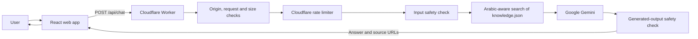

# 🕌 Muslim Apps Assistant

**A bilingual assistant for discovering useful Islamic apps and checking local prayer times.**

[Live Demo](https://cooolv.github.io/Muslim-Bot/) · [Docs](#quick-start) · [Report an issue](https://github.com/cooolv/Muslim-Bot/issues)

[](LICENSE)
[](https://github.com/cooolv/Muslim-Bot/actions/workflows/pages.yml)
[](https://www.typescriptlang.org/)
[](https://github.com/cooolv/Muslim-Bot/commits/main)
[](https://github.com/cooolv/Muslim-Bot/pulls)

**Language:** English · [العربية](README.ar.md)

## Preview

> **Screenshot requested:** Add an actual screenshot or GIF of the live app at `docs/images/preview.png`. No project screenshot is included yet.


## Why this project?

Muslims looking for useful apps often have to search across scattered sources. Muslim Apps Assistant brings curated app information, source links, and prayer-time tools into one Arabic- and English-language web app. It is also a small, inspectable example for developers exploring retrieval-augmented generation (RAG) for Arabic.

## Features

- **Knowledge-grounded answers:** The Cloudflare Worker searches the published records in `public/knowledge.json` and gives matching context and source links to Gemini.
- **Broad app recommendations:** When a user asks generally for a useful Islamic app without naming a category or product, the Worker offers a curated set of apps already in the knowledge base, with source links.
- **Arabic-aware retrieval:** Search normalizes Arabic letters and diacritics, stems common prefixes and suffixes, and ranks matching knowledge records locally.
- **Prayer times and city lookup:** Search for a city or allow browser location access, then request prayer times from Aladhan. The page shows the five daily prayers, Hijri date, and next prayer.
- **Personalized display:** Switch Arabic/English and light/dark themes, choose message text size (including extra large) and accent color, and control whether assistant replies use a distinct background. Chat bubbles align like a two-sided conversation in each language.
- **Local preferences and conversation history:** Conversations, display preferences, selected city, and the reminder toggle are stored in the browser. Display preferences can be restored to their defaults in Settings.
- **Layered request protections:** The Worker checks origins and request shape and size, applies Cloudflare rate limiting, checks input and generated output, and keeps the Gemini key on the server.
- **Source links:** Answers can include links to the knowledge records used for retrieval.
- **Maintainer-reviewed knowledge suggestions:** Anyone can propose source-backed information through a public GitHub issue. Suggestions are not used in answers unless a maintainer reviews and adds them to the published knowledge file.

Scheduled prayer reminders are **not implemented**. The current reminder control only saves a local preference; it does not schedule or deliver notifications.

## How it works



The browser sends the current question and a limited recent conversation history to `/api/chat`; it never calls Gemini directly. The Worker handles origin and request validation, rate limiting, input checks, knowledge retrieval, and output checks. It imports `public/knowledge.json` at build time, selects relevant records with the shared Arabic search helpers, and passes those records to Gemini as reference context.

Cloudflare rate limiting runs at the Worker boundary. Input and output checks run in the Worker using shared project code. These protections reduce risk; they do not guarantee that every unsafe or incorrect response will be prevented.

## Quick Start

### Requirements

- Node.js 22 (the version used by the GitHub Actions workflow) and npm.
- A [Google Gemini API key](https://aistudio.google.com/apikey) for local chat or a deployed Worker.
- Python 3.12 only if you also want to run the legacy Python test suite.

### Run the web app and Worker locally

1. Install the JavaScript dependencies:

   ```bash
   npm ci
   ```

2. Create a `.dev.vars` file in the project root and set `GEMINI_API_KEY` to your own Gemini API key. Keep this secret out of Git and do not put it in a `VITE_*` variable.

3. In one terminal, start the local Worker:

   ```bash
   npm run worker:dev
   ```

4. In another terminal, create `.env.local` and set `VITE_CHAT_API_URL` to the local Worker URL shown by Wrangler (normally `http://localhost:8787`). Then start Vite:

   ```bash
   npm run dev
   ```

5. Open the local Vite URL printed in the terminal.

The local Worker origin is included in the repository's `ALLOWED_ORIGINS` configuration. If you change the development host or port, update that setting and restart the Worker.

### Run the checks

```bash
npm test
npm run typecheck
npm run build
```

To run the legacy Python tests as well:

```bash
python -m pip install -r requirements-dev.txt
python -m pytest -q
```

## Configuration

The current web app does not load the legacy Python bot's `.env` settings. Set the frontend URL locally with `VITE_CHAT_API_URL`; set the Gemini credential as a Cloudflare secret. The following names describe the current web deployment:

| Name | Purpose | Where it is configured |
| --- | --- | --- |
| `VITE_CHAT_API_URL` | Public base URL of the chat Worker; included in the frontend build. It is not a secret. | Local `.env.local` or GitHub Actions repository variable |
| `GEMINI_API_KEY` | Credential used by the Worker to call Gemini. | Local `.dev.vars` for Wrangler development; Cloudflare Worker secret for deployment |
| `GEMINI_MODEL` | Gemini model name used by the Worker. | `wrangler.jsonc` variable; can be overridden in the Worker environment |
| `ALLOWED_ORIGINS` | Comma-separated browser origins permitted by the Worker. | `wrangler.jsonc` variable |
| `CHAT_RATE_LIMITER` | Cloudflare rate-limiting binding used by the Worker. | Configured in `wrangler.jsonc`; not an application secret |

Never put `GEMINI_API_KEY` or another credential in `VITE_*`, frontend code, or committed files. The legacy Python modules have their own settings, but they are not used by the current web runtime.

## Deployment

The site and chat backend are separate deployment targets. After one-time Cloudflare credentials are saved as GitHub repository secrets, a successful push to `main` deploys both automatically after the build and tests pass. Pull requests do not deploy either target.

### Frontend: GitHub Pages

1. In the repository's **Settings → Secrets and variables → Actions → Variables**, set the repository variable `VITE_CHAT_API_URL` to the deployed Worker base URL.
2. In **Settings → Pages**, select **GitHub Actions** as the build and deployment source.
3. Push or merge to `main`. The workflow at `.github/workflows/pages.yml` runs tests and checks, builds the static site, and deploys it to GitHub Pages. Pull requests run the build and checks but do not deploy.

### Backend: Cloudflare Workers

Configure these credentials once in **GitHub repository → Settings → Secrets and variables → Actions → New repository secret**:

- `CLOUDFLARE_API_TOKEN`: Create a [Cloudflare API token](https://developers.cloudflare.com/fundamentals/api/get-started/create-token/) scoped to the account and with permission to edit Workers. Treat it as a secret.
- `CLOUDFLARE_ACCOUNT_ID`: The [Cloudflare account ID](https://developers.cloudflare.com/fundamentals/account/find-account-and-zone-ids/) for the account containing this Worker. Store it as a repository secret as well.

The workflow uses these credentials to run `npm run worker:deploy` after the build job succeeds on pushes to `main`. It does not expose them to pull-request jobs. Keep the existing `GEMINI_API_KEY` Worker secret configured in Cloudflare; it is not replaced by the deployment token.

Set the GitHub Actions variable `VITE_CHAT_API_URL` to the Worker URL and ensure the frontend origin is included in `ALLOWED_ORIGINS`. After the one-time setup, an approved knowledge change merged into `main` is deployed automatically with the Worker; no per-change Wrangler command is needed. A manual `npm run worker:deploy` remains available for intentional manual deployments.

Cloudflare and Gemini plans, quotas, and limits can change. Check the [Cloudflare Workers limits](https://developers.cloudflare.com/workers/platform/limits/), [Gemini API rate limits](https://ai.google.dev/gemini-api/docs/rate-limits), and your account settings before deployment; this README does not promise free or unlimited usage.

## Project Structure

```text
.
├── .github/workflows/pages.yml  # Test, build, and GitHub Pages deployment workflow
├── bot/                         # Legacy Python modules; not the web runtime
│   ├── __init__.py              # Legacy bot package
│   ├── arabic.py                # Legacy Arabic search helpers
│   ├── assistant.py             # Legacy assistant orchestration
│   ├── blocklist.py             # Legacy blocklist support
│   ├── config.py                # Legacy Python environment settings
│   ├── countries.py             # Legacy country and prayer-method data
│   ├── db.py                    # Legacy database layer
│   ├── guard.py                 # Legacy safety checks
│   ├── knowledge.py             # Legacy knowledge indexing helpers
│   ├── llm.py                   # Legacy LLM client
│   ├── prayer.py                # Legacy prayer-time helpers
│   └── prompts.py               # Legacy assistant prompts
├── data/.gitkeep                # Keeps the otherwise empty legacy data directory
├── index.html                   # Vite HTML entry point
├── public/knowledge.json        # Published knowledge records
├── src/
│   ├── App.tsx                  # React UI, conversation experience, and prayer-times page
│   ├── chat.ts                  # Browser-to-Worker chat client
│   ├── core.ts                  # Shared types, Arabic search, safety checks, and browser storage
│   ├── core.test.ts             # Shared frontend/core tests
│   ├── main.tsx                 # Frontend entry point
│   ├── styles.css               # Application styles
│   └── vite-env.d.ts            # Vite environment type declarations
├── tests/                        # Legacy Python module tests
│   ├── __init__.py               # Python test package
│   ├── conftest.py               # Python test setup
│   ├── test_arabic.py            # Legacy Arabic search tests
│   ├── test_assistant.py         # Legacy assistant tests
│   ├── test_guard.py             # Legacy safety tests
│   ├── test_knowledge.py         # Legacy knowledge indexing tests
│   └── test_prayer.py            # Legacy prayer helper tests
├── worker/src/
│   ├── index.ts                 # Cloudflare chat Worker and knowledge retrieval
│   └── index.test.ts            # Worker tests with a mocked Gemini API
├── .env.example                 # Public frontend URL variable example
├── .gitignore                   # Local secrets, dependencies, and build output exclusions
├── LICENSE                      # MIT License
├── README.md                    # Project documentation
├── README.ar.md                 # Arabic project documentation
├── package-lock.json            # Locked npm dependency versions
├── package.json                 # JavaScript scripts and dependencies
├── pytest.ini                   # Pytest configuration
├── requirements.txt             # Legacy Python runtime dependencies
├── requirements-dev.txt         # Legacy Python test dependency
├── tsconfig.json                # TypeScript project references
├── tsconfig.app.json             # Frontend TypeScript configuration
├── tsconfig.node.json            # Node tooling TypeScript configuration
├── tsconfig.worker.json          # Worker TypeScript configuration
├── vite.config.ts               # Vite build configuration
├── vitest.config.ts             # Vitest configuration
└── wrangler.jsonc               # Cloudflare Worker configuration
```

## Security & Safety

- The Gemini API key is a Worker secret and is not included in the frontend build.
- The Worker restricts browser origins, validates requests, limits request size, and uses a Cloudflare rate-limiting binding.
- Shared input and output checks screen requests and generated text. Retrieved records are treated as reference data, not instructions.
- CORS is not authentication. A non-browser client can call a public Worker, and rate limits or provider quotas do not prevent every form of abuse.
- AI output and automated checks can be wrong or incomplete. No security or content-safety system is absolute.

To report a suspected vulnerability, follow [SECURITY.md](SECURITY.md). Avoid posting exploitable details in a public issue.

## Privacy

- The browser stores conversations, language/theme preferences, the selected city, and the reminder preference in local storage. Use the app's local-data deletion control to clear saved app data from that browser.
- The current question and a limited recent chat history are sent to the Worker and then to Google Gemini to generate a response. The Gemini key is not sent to the browser.
- The Worker does not store conversation history in an application database. Cloudflare and Google may process request data under their own services and policies; review their current terms before use.
- City searches send the city query to OpenStreetMap's Nominatim service. Prayer-time requests send coordinates and a calculation method to Aladhan. Browser location is requested only when the user chooses the location feature.
- The app does not require an account.

Do not submit sensitive personal, health, financial, or other confidential information.

## Knowledge suggestions and the knowledge base

To propose information, open a [Knowledge suggestion](https://github.com/cooolv/Muslim-Bot/issues/new?template=knowledge_suggestion.yml) issue with the factual claim and its sources. Suggestions are public, remain pending until reviewed, and are not sent to Gemini or included in retrieval just because an issue was opened. Do not include personal or confidential information.

Only a maintainer decides whether a suggestion is accepted. If accepted, the maintainer manually adds a record to `public/knowledge.json`, checks its facts and sources, and publishes the change. Rejected suggestions are not added. The issue form does not provide an in-app admin panel, a separate admin-role system, or automatic changes to the knowledge base; repository write access and branch rules govern who can change the file.

Knowledge is retrieved using RAG; submitting or approving a suggestion does **not** train or fine-tune Gemini. To add an approved record, use this structure:

```json
{
  "title": "Example app",
  "appName": "Example app",
  "description": "A concise, source-backed description.",
  "features": ["A verified feature"],
  "keywords": ["Arabic search term", "English search term"],
  "sources": [
    { "title": "Official page", "url": "https://example.org/app" }
  ],
  "body": "Additional reference text for retrieval.",
  "trust": 3
}
```

The Worker imports this JSON during its build, so approved changes require redeploying the Worker. The GitHub Pages workflow also packages the public file with the frontend; push the change to `main` to publish the updated site.

The current UI supports Arabic and English, and the backend calls Gemini directly. Adding another UI language or LLM provider is not a configuration-only change: it requires code changes and tests.

## Testing

```bash
npm test
npm run typecheck
npm run build
```

The Vitest suite covers Arabic normalization and search, safety helpers, prayer-time helpers, and Worker behavior using a mocked Gemini response. It does not require a live API key. The GitHub Actions workflow also installs the legacy Python test dependencies and runs `python -m pytest -q`.

When adding functionality, add a focused test alongside the existing test for the relevant module. For Worker changes, test the request/response behavior and inspect the mocked upstream request where relevant. Do not use real credentials in tests.

## Roadmap

- [ ] Implement scheduled prayer reminders; the current reminder toggle only stores a local preference.
- [ ] Add an in-app knowledge suggestion and admin review panel; suggestions are currently collected and reviewed through public GitHub issues.
- [ ] Add real screenshots to `docs/images/` after the project owner provides them.
- [ ] Evaluate additional LLM providers and UI languages with explicit code, safety, and test changes.

## FAQ

### Is the app free?

The repository is open source under the MIT License. Running the hosted app depends on GitHub, Cloudflare, and Gemini account plans and quotas; this project does not guarantee free or unlimited hosting or inference.

### Does it issue Islamic rulings?

No. **This is an AI assistant, not a mufti.** It can make mistakes and should not be treated as a source of fatwas. Ask qualified scholars about personal or detailed religious questions.

### Which LLM provider is supported?

The current Worker calls Google Gemini. `GEMINI_MODEL` selects the configured Gemini model; another provider would require backend code changes.

### How can I suggest app information?

Open a [Knowledge suggestion issue](https://github.com/cooolv/Muslim-Bot/issues/new?template=knowledge_suggestion.yml). A maintainer reviews it; opening an issue does not add its contents to answers. If accepted, the maintainer updates the knowledge file and deploys the change.

### Does this train Gemini?

No. Approved information is added to the RAG knowledge base and retrieved as context for answers. Gemini's model weights are not trained or fine-tuned by this workflow.

### Do prayer reminders work?

No. Scheduled reminders are not implemented. The current control only saves an on/off preference in the browser.

### Does the app save my chats on a server?

The app stores chat history in the browser's local storage, not in an application database. Messages are sent to the Worker and Google Gemini to produce answers; see [Privacy](#privacy) and the providers' policies.

## Project History

The first version of this project was a Telegram bot. Its earlier implementation is preserved in the [`live-verison`](https://github.com/cooolv/Muslim-Bot/tree/live-verison) and [`sync`](https://github.com/cooolv/Muslim-Bot/tree/sync) branches. The current `main` branch's deployed product is the web application described above; the legacy Python modules still present in the tree are not part of its runtime.

## Contributing

Contributions are welcome. Read [CONTRIBUTING.md](CONTRIBUTING.md) and [CODE_OF_CONDUCT.md](CODE_OF_CONDUCT.md), open an issue to discuss substantial changes, keep pull requests focused, and include tests for behavior changes. Review the current [issues](https://github.com/cooolv/Muslim-Bot/issues) and [pull requests](https://github.com/cooolv/Muslim-Bot/pulls) before starting.

## License

This project is distributed under the [MIT License](LICENSE).

## Acknowledgements

- [Google Gemini](https://ai.google.dev/gemini-api/docs) for AI-generated responses.
- [Cloudflare Workers](https://developers.cloudflare.com/workers/) for the chat API runtime and rate-limiting binding.
- [Aladhan](https://aladhan.com/prayer-times-api) for prayer-time data.
- [OpenStreetMap Nominatim](https://nominatim.org/release-docs/latest/api/Search/) for city search.
- The maintainers and contributors of the open-source packages listed in `package.json`.

This is an AI assistant, not a mufti. Verify important information with reliable sources and qualified scholars.
